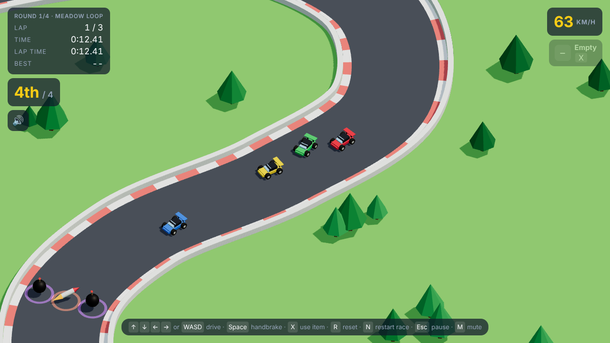
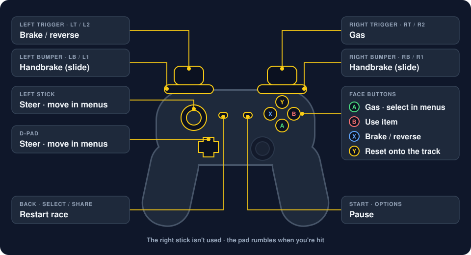

# RC Racer

[](https://github.com/wayne-folkes/rc-racer/actions/workflows/ci.yml)

A browser racing game in the spirit of RC Pro-Am: low-poly RC cars on a track seen from a fixed
3/4 camera. TypeScript + Vite + Three.js, no backend yet.



**Play it at [racer.folkes.dev](https://racer.folkes.dev)**, or run it yourself below.

## Run it

```bash
cd client
npm install
npm run dev
```

The game opens on a title screen with Continue, New season, Records, Settings (sound, volume, reset
progress) and How to play. New season asks you to pick a circuit, then a Buggy or a Monster Truck, and
everyone on the track drives the same one. Both circuits are open from the start and run four rounds:
the Classic Cup (meadow, desert, lakeside, snow) and the Space Cup, which races over the Moon (Tranquility
Run), Mars (Olympus Rally), Io (Pele Loop) and Europa (Conamara Run), each with its own scenery and weather. The buggy is quicker and sharper; the truck is a few percent slower
and softer to steer, but its big tires shrug off oil and puddles. Easy mode, a switch on the same
screen, starts you 2nd (instead of 4th) and makes the opponents a little slower. Reverse, a switch on the
circuit screen, drives every track the other way round. Every circuit, vehicle and direction has its own records.

`npm test` runs the unit tests (handling, track maths, collisions, race rules, AI, items, season
rules, and full four-car races on every track). `npm run build` type-checks and builds to `client/dist`.

## Controls

Keyboard, gamepad and touch all work, and you can switch between them mid-race.

### Keyboard

| Action | Keys |
|---|---|
| Gas / brake and reverse | Up / Down, or W / S |
| Steer | Left / Right, or A / D |
| Handbrake (slide) | Space |
| Use item | X or Shift |
| Reset onto the track | R |
| Restart race | N (or Enter on the results screen) |
| Pause | Esc or P |
| Mute | M (or the speaker button under your race position) |
| Menus | Arrow keys to move, Enter to select |

### Gamepad

Any controller with the browser's "standard" layout works, which covers Xbox, PlayStation and most
others. It rumbles when you're hit.



| Action | Xbox | PlayStation |
|---|---|---|
| Steer | Left stick or d-pad left / right | Left stick or d-pad left / right |
| Gas | RT or A | R2 or ✕ |
| Brake / reverse | LT or X | L2 or □ |
| Handbrake (slide) | LB or RB | L1 or R1 |
| Use item | B | ○ |
| Reset onto the track | Y | △ |
| Restart race | Back | Share / Create |
| Pause | Start | Options |
| Menus | D-pad or left stick to move, A to select | D-pad or left stick to move, ✕ to select |

### Touch

On touch screens an on-screen steering pad sits under your left thumb, with gas, brake, drift and
item buttons under your right, and small reset and pause buttons in the top-right corner.

## Deploy

Pushes to `main` run CI (`.github/workflows/ci.yml`: unit tests and build) and deploy to Vercel,
which builds `client/` as a static site (`vercel.json`). Pull requests get preview deployments.

## Layout

- `client/src/main.ts`: renderer, lights, fixed-timestep game loop, HUD.
- `client/src/game/carPhysics.ts`: arcade handling. All the feel lives in `DEFAULT_TUNING`.
- `client/src/game/trackPath.ts`: track centreline, projection onto it, the demo layout.
- `client/src/game/collision.ts`: walls and car-to-car bumps.
- `client/src/game/race.ts`: race rules: countdown, checkpoints, laps, standings.
- `client/src/game/world.ts`: the whole race simulation (cars, AI, collisions, rules) without rendering.
- `client/src/game/racingLine.ts`, `aiDriver.ts`, `racers.ts`: AI racing line, driving, opponents and grid.
- `client/src/game/items.ts`: pickups, missiles, bombs, boost pads, oil and puddles, and the demo layout.
- `client/src/game/jumps.ts`: ramps, car height and jumping. Airborne cars can't steer and pass over
  pickups, hazards, bombs and other cars.
- `client/src/game/tracks.ts`, `spaceTracks.ts`: the circuits and their tracks, each with its layout and
  theme, and the reversed copy of each. `tracks.test.ts` checks every track both ways round (corner radii,
  spacing, hazard placement, a full AI race).
- `client/src/game/season.ts`, `seasonStorage.ts`: season rules (prize money, upgrades, difficulty per
  round, top three or game over) and saving progress in the browser.
- `client/src/game/vehicles.ts`: the buggy and the monster truck: names, blurbs and handling. The truck is the
  buggy's `DEFAULT_TUNING` with a few numbers changed.
- `client/src/game/controls.ts`, `input.ts`, `gamepad.ts`, `touch.ts`: keyboard, gamepad and touch input,
  merged into one set of controls.
- `client/src/game/audio.ts`: engine notes and sound effects, synthesized with the Web Audio API (no
  sound files).
- `client/src/game/carModel.ts`, `trackScene.ts`, `itemScene.ts`, `weatherScene.ts`, `followCamera.ts`:
  visuals.

## Contributing

Contributions are welcome, from bug fixes to new tracks. See [CONTRIBUTING.md](CONTRIBUTING.md) for how
to get started, and please follow the [Code of Conduct](CODE_OF_CONDUCT.md). The title screen's
"Contribute on GitHub" link brings you here.

## Roadmap

1. One car on a track, tuned until it's fun to drive. **(done)**
2. Proper race: countdown, checkpoints, 3-lap races, results. **(done)**
3. AI opponents following the racing line, race positions. **(done)**
4. Pickups and weapons (missiles, bombs), boost pads, oil slicks and puddles. **(done)**
5. Progression: several tracks, upgrades between races, top-3-or-game-over. **(done)**
6. Polish: sound, gamepad and touch controls, title and pause menus, ramps and jumps **(done)**; track
   editor.

Later: a Roblox version. The plan, and a first spike to size it up, are in
[docs/roblox-port.md](docs/roblox-port.md).
